# TP1 – Déploiement d'un portfolio Next.js avec Ansible et Semaphore UI

**Étudiante :** Amal Jemli – Master DevOps et Cloud Computing
**Énoncé :** [TP1 – Ansible + Semaphore UI](https://docs.teknolabs.net/courses/devops-cloud/partie-1-deploiement-application/tp1-ansible-semaphore/)
**Application déployée :** le portfolio Next.js du dépôt [Amal356/cv-devsecops](https://github.com/Amal356/cv-devsecops) (dossier `portfolio-next`)

Playbook Ansible **idempotent**, structuré en **rôles**, qui déploie le portfolio sur un serveur Ubuntu 24.04 vierge :
Node.js 22 (NodeSource) → application lancée par **PM2** sur le port 3000 → **Nginx** en reverse proxy sur le port 80.
L'exécution est ensuite confiée à **Semaphore UI**.

Rapport : [RAPPORT.md](RAPPORT.md) – Captures : [captures/](captures)

## Architecture

Trois VM VirtualBox sur le réseau privé hôte `192.168.56.0/24` :

| VM | Rôle | IP | Création |
|---|---|---|---|
| `ansible-admin` | machine de contrôle : Ansible 2.16 et Git (partie A) | 192.168.56.20 | Vagrant (activité 3) |
| `docker-vm` | Semaphore UI dans Docker (partie B) | 192.168.56.30 | Vagrant, Docker installé par Ansible (activité 3) |
| `tp1-server` | **serveur cible vierge** Ubuntu 24.04 | 192.168.56.50 | Vagrant ([`vagrant/Vagrantfile`](vagrant/Vagrantfile)) |

```
 Windows (navigateur)
   │ http://192.168.56.30:3000              http://192.168.56.50
   ▼                                          ▼
 docker-vm : Semaphore UI ── SSH (deploy) ─▶ tp1-server : Nginx :80 → PM2 → Next.js :3000
                 ▲                            ▲
           git clone (GitHub)                 │ SSH (deploy)
                                       ansible-admin : ansible-playbook (partie A)
```

Le serveur cible ne reçoit qu'une préparation minimale par Vagrant ([`preparer-deploy.sh`](vagrant/scripts/preparer-deploy.sh)) : l'utilisateur `deploy`, la clé SSH d'`ansible-admin` et `sudo` sans mot de passe. C'est le prérequis de l'énoncé (« accès SSH par clé »). Tout le reste est installé par le playbook. `vagrant destroy -f && vagrant up` redonne une VM vierge.

## Structure

```
tp1-ansible-semaphore/
├── ansible.cfg
├── inventory/hosts.ini           # tp1-server, utilisateur deploy
├── group_vars/all.yml            # toutes les variables (aucune valeur en dur)
├── site.yml                      # playbook principal + vérification HTTP finale
├── collections/requirements.yml  # community.general (module npm)
├── semaphore/                    # docker-compose de Semaphore, .env.example, groupe de variables
├── vagrant/                      # Vagrantfile du serveur cible
└── roles/
    ├── common/   # apt update, git/curl/build-essential/acl, utilisateur deploy
    ├── nodejs/   # dépôt NodeSource (deb822), Node.js 22, PM2
    ├── app/      # git clone, npm ci, npm run build, PM2 + handler de redémarrage
    └── nginx/    # vhost Jinja2, activation, handlers test + reload
```

## Rôles

| Ordre | Rôle | Tâches |
|---|---|---|
| 1 | `common` | cache apt (au plus une fois par heure), paquets de base, utilisateur `deploy` |
| 2 | `nodejs` | clé GPG et dépôt NodeSource au format deb822, Node.js 22, PM2 global |
| 3 | `app` | clone du dépôt dans `/opt/portfolio`, `npm ci` et `npm run build` dans `portfolio-next`, démarrage PM2 sur le port 3000, PM2 au démarrage (systemd) |
| 4 | `nginx` | Nginx, vhost `portfolio.conf` généré depuis un template Jinja2 (proxy vers `127.0.0.1:3000`, en-têtes `Host`, `X-Real-IP`, `X-Forwarded-For`), site activé, site par défaut retiré |

Le portfolio est dans un **sous-dossier** du dépôt : `app_dir` est le clone (`/opt/portfolio`), `app_src_dir` (`/opt/portfolio/portfolio-next`) le dossier où sont lancés `npm` et PM2.

## Choix d'idempotence

| Point | Solution |
|---|---|
| `apt update` | `cache_valid_time: 3600` : pas de « changed » à chaque exécution |
| `npm ci` / `npm run build` | exécutés **seulement si** la tâche `git` a changé (ou si `node_modules` / `.next/BUILD_ID` manquent) |
| Démarrage PM2 | `pm2 describe` d'abord ; `pm2 start` seulement si le processus n'existe pas |
| Redémarrage de l'application | **handler** `Redémarrer le portfolio`, notifié par la tâche `git` : uniquement si le code a changé |
| Nginx | template + handlers `nginx -t` puis `reload` |
| PM2 au démarrage | `creates:` sur le service systemd généré |

## Partie A – Exécution en ligne de commande

Depuis `ansible-admin` :

```bash
git clone git@github.com:Amal356/devops-partie1.git
cd devops-partie1/tp1-ansible-semaphore
ansible all -m ping
ansible-playbook -i inventory/hosts.ini site.yml --syntax-check
ansible-playbook -i inventory/hosts.ini site.yml --check --diff
ansible-playbook -i inventory/hosts.ini site.yml
ansible-playbook -i inventory/hosts.ini site.yml   # 2e exécution : changed=0
```

> `--check` sur un serveur **vierge** : certaines tâches dépendent de résultats qui n'existent pas encore (npm, PM2) et sont ignorées en mode check. Le dry-run est plus parlant **après** le premier déploiement.

Le portfolio est accessible sur `http://192.168.56.50`. Pour utiliser le nom `portfolio.local`, ajouter `192.168.56.50 portfolio.local` au fichier `C:\Windows\System32\drivers\etc\hosts`.

## Partie B – Semaphore UI

Semaphore tourne sur `docker-vm`, pas sur le serveur cible : le port 3000 y est utilisé par Next.js.

```bash
cd semaphore
cp .env.example .env
# remplir .env : mot de passe admin, et clé générée avec  head -c32 /dev/urandom | base64
docker compose up -d     # http://192.168.56.30:3000
```

Le mot de passe et la clé de chiffrement du Key Store sont dans `.env`, exclu par `.gitignore` : aucun secret dans le dépôt.

| Étape | Menu | Valeur |
|---|---|---|
| 1 | Projects → New | `portfolio-deploy` |
| 2 | Key Store | *SSH Key* `deploy-ssh` (clé privée autorisée pour `deploy`) ; *None* pour le dépôt public |
| 3 | Repositories | `https://github.com/Amal356/devops-partie1.git`, branche `main` |
| 4 | Inventory | Static, contenu de `inventory/hosts.ini`, User Credentials : `deploy-ssh` |
| 5 | Variable Groups | `portfolio-vars` : contenu de `semaphore/variable-group.json` |
| 6 | Task Templates → New | **Deploy Portfolio**, playbook `site.yml`, inventaire, dépôt, groupe de variables |
| 7 | Survey Variable | `app_version` (« Branche ou tag », défaut `main`) |

Lancer **Deploy Portfolio**, suivre les logs, modifier une page du portfolio, pousser, relancer : la tâche `git` passe en *changed* et le handler **RUNNING HANDLER [app : Redémarrer le portfolio]** s'exécute. Sans changement de code, le handler n'apparaît pas.

## Dépannage

- **`git` reste « changed » au 2e run** : le build réécrit un fichier suivi par Git. Le commiter tel que généré dans le dépôt du portfolio.
- **`become_user` échoue (« chmod: invalid mode »)** : paquet `acl` absent ; il est installé par le rôle `common`.
- **502 Bad Gateway** : l'application n'écoute pas encore sur 3000 → `sudo -u deploy pm2 logs portfolio`.

## Résultats

### Partie A – ligne de commande (depuis `ansible-admin`)

Connexion et syntaxe :

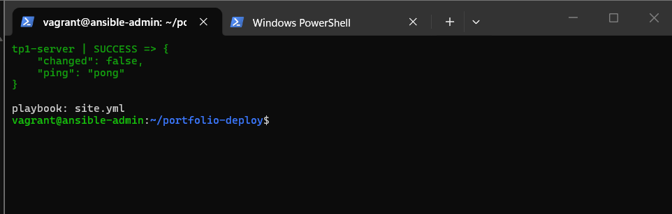

Dry-run `--check --diff` : `ok=20 changed=9 failed=0 skipped=8 ignored=5`. Le `--diff` montre à l'avance le vhost Nginx généré par le template. La première tentative avait échoué faute de `python3-debian` (voir le [rapport](RAPPORT.md)) :

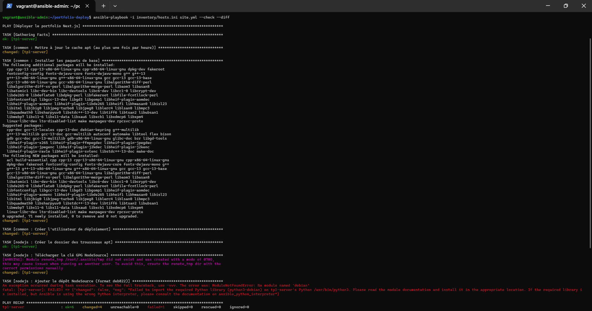

Premier déploiement : `ok=26 changed=9 failed=0`. La dernière tâche vérifie que le portfolio répond en HTTP 200 via Nginx.

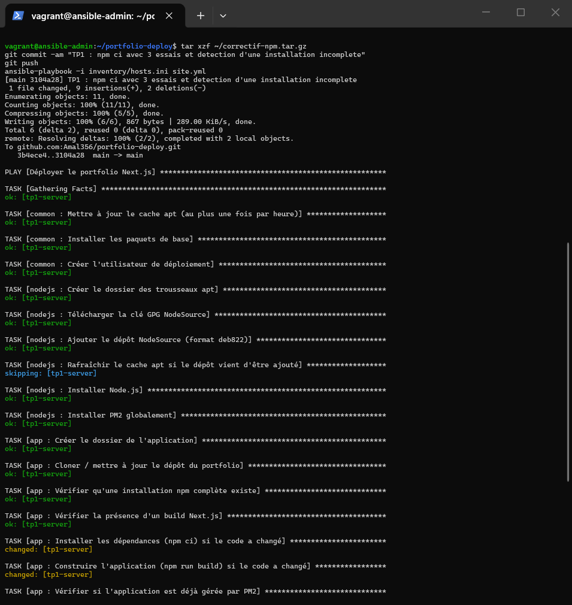

Le portfolio sur `http://192.168.56.50` :

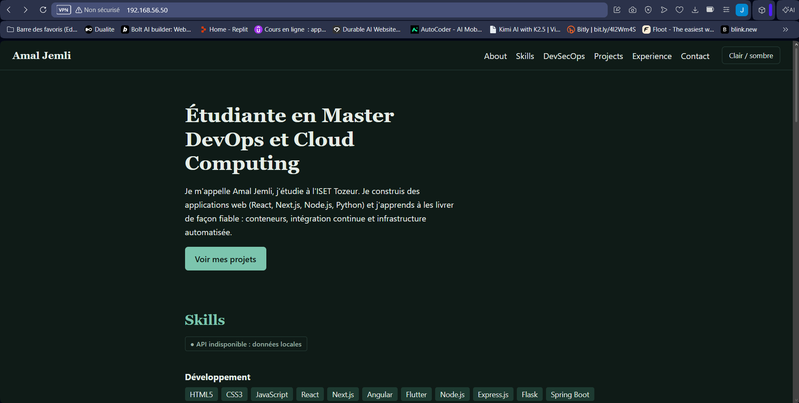

Deuxième exécution : **`changed=0`**, le playbook est idempotent.

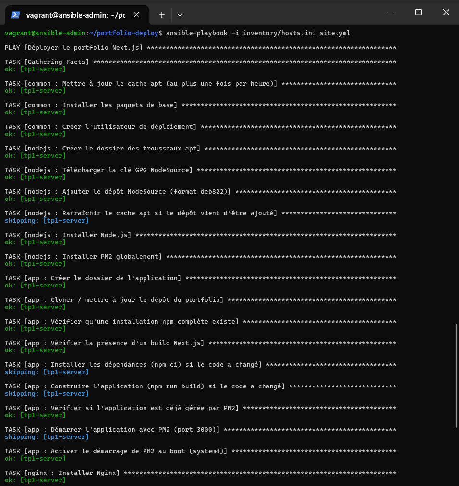

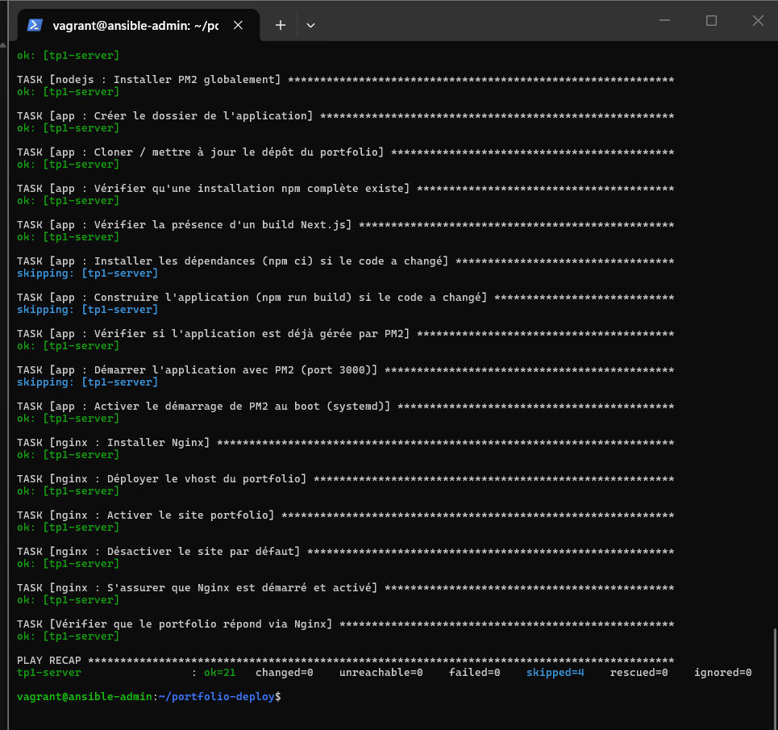

### Partie B – Semaphore UI

Clé SSH dédiée à Semaphore, installée sur le serveur avec Ansible :

```bash
# sur docker-vm
ssh-keygen -t ed25519 -C "semaphore" -N "" -f ~/.ssh/semaphore_deploy
# sur ansible-admin
ansible web -b -m ansible.posix.authorized_key -a "user=deploy key='ssh-ed25519 AAAA... semaphore'"
```

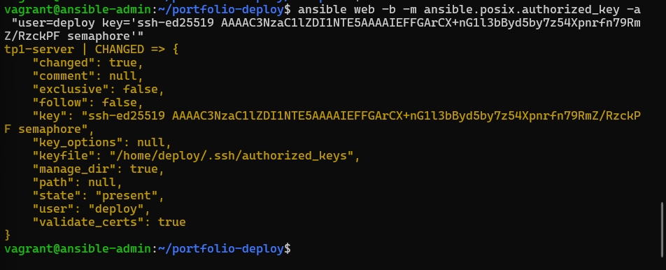

Key Store, Repository, Inventory et Variable Group :

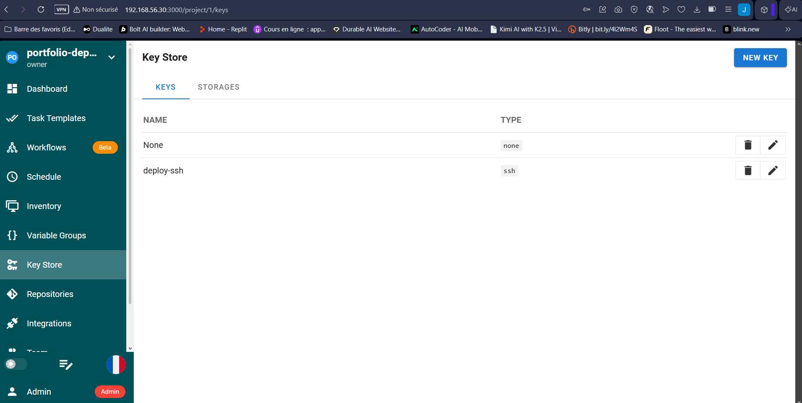


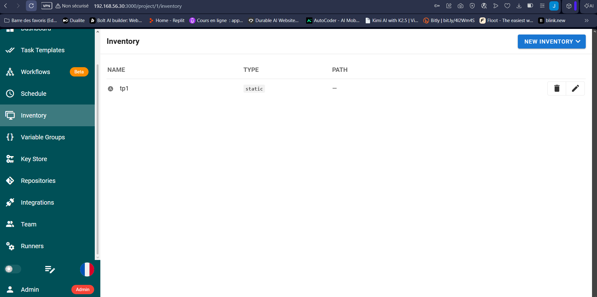

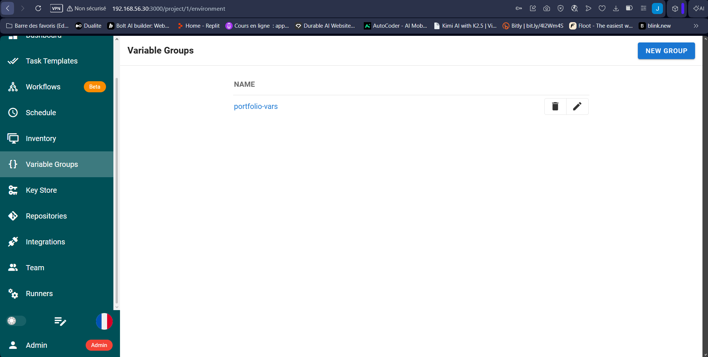

Survey variable `app_version` (passée en *extra var*) et template **Deploy Portfolio** :

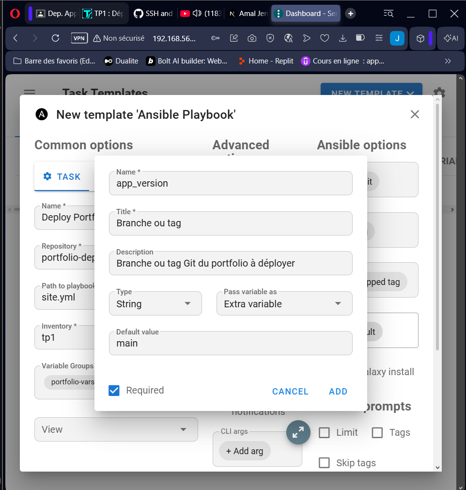

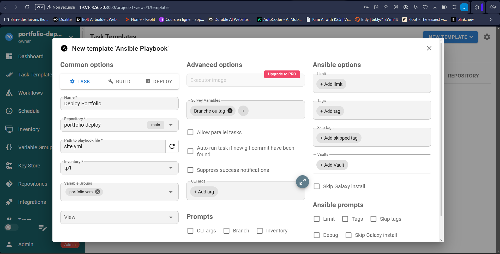

Run #1 : **Success**, `failed=0`.

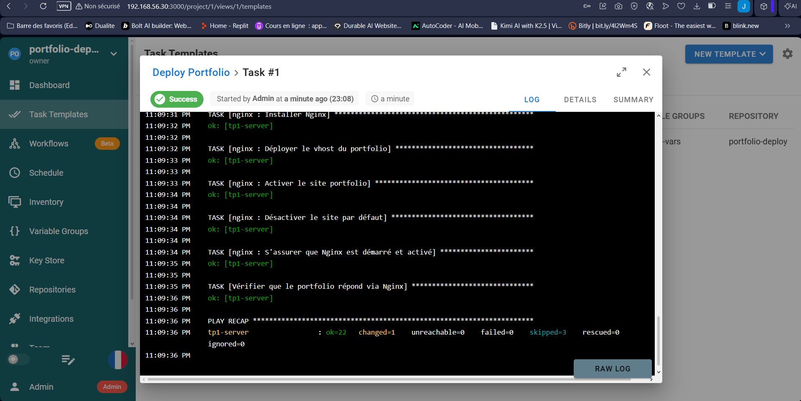

### Mise à jour du portfolio et redémarrage conditionnel

Une phrase est ajoutée à la page d'accueil du portfolio (commit sur `cv-devsecops`), puis **Deploy Portfolio** est relancé. La tâche `git` passe en *changed* :

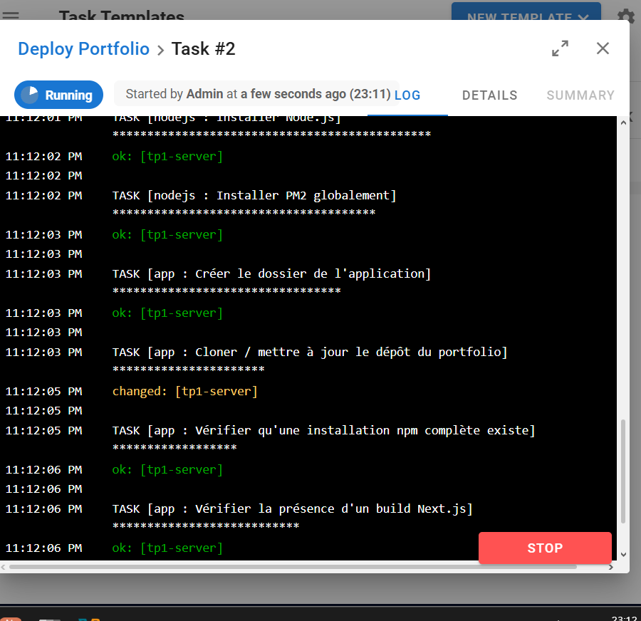

`npm ci` et `npm run build` s'exécutent, puis le handler **Redémarrer le portfolio**. Il ne s'était pas exécuté au run #1, sans changement de code.

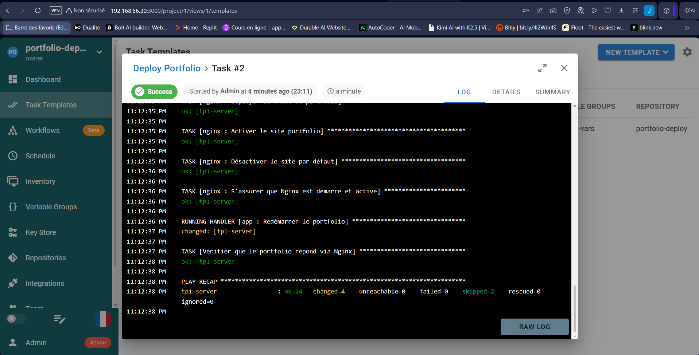

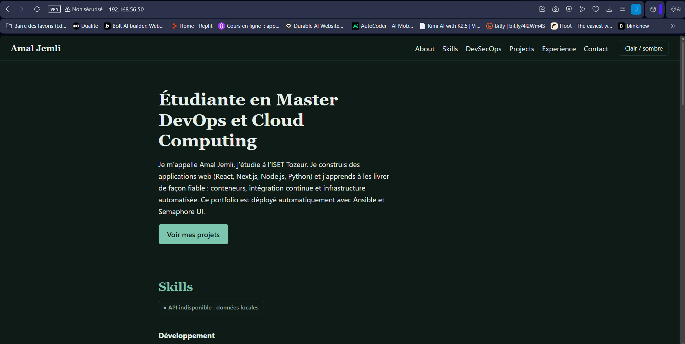
