# TP2 – Coolify + Forgejo : PaaS auto-hébergé et forge Git locale

**Étudiante :** Amal Jemli – Master DevOps et Cloud Computing
**Énoncé :** [TP2 – Coolify + Forgejo](https://docs.teknolabs.net/courses/devops-cloud/partie-1-deploiement-application/tp2-coolify/index.html)
**Application déployée :** le portfolio Next.js du TP1 ([cv-devsecops/portfolio-next](https://github.com/Amal356/cv-devsecops))

Le portfolio est hébergé dans une **forge Git locale (Forgejo)** et déployé par un **PaaS auto-hébergé (Coolify)**. Un **webhook** relie les deux : chaque `git push` sur `main` reconstruit et redéploie l'application, sans action manuelle. Tout tourne dans une seule VM, sans domaine DNS ni compte GitHub.

Rapport : [RAPPORT.md](RAPPORT.md) – Captures : [captures/](captures)

## Architecture

```
 Windows (navigateur, fichier hosts)
   │  http://192.168.56.70:8000   http://192.168.56.70:3001   http://portfolio.coolify.local
   ▼
 VM coolify-vm – Ubuntu 24.04 – 192.168.56.70 – 2 vCPU, 4 Go
 ├── Coolify v4.4.7 (:8000)   interface, PostgreSQL, Redis, Sentinel
 ├── Traefik v3.7  (:80)      proxy : Host(portfolio.coolify.local) → conteneur :3000
 ├── Forgejo 16    (:3001)    dépôt amal/portfolio
 └── portfolio (Next.js)      image construite depuis le Dockerfile, tag = commit Git

 git push ─▶ Forgejo ─ webhook (POST signé) ─▶ Coolify ─ clone + docker build ─▶ nouveau conteneur
```

| Port | Service | Rôle |
|---|---|---|
| 8000 | Coolify | Dashboard |
| 80 | Traefik (`coolify-proxy`) | Reverse proxy des applications |
| 3001 | Forgejo (web) | Forge Git (3000 est réservé à Next.js) |
| 2222 | Forgejo (SSH) | Clonage SSH |

## Structure

```
tp2-coolify-forgejo/
├── README.md
├── RAPPORT.md
├── vagrant/Vagrantfile          # VM coolify-vm
├── forgejo/docker-compose.yml   # Forgejo 16 (fichier fourni par le TP)
└── captures/
```

## Partie A – Coolify

```powershell
# Windows, dossier de la VM
vagrant up
vagrant ssh
```

```bash
ip -4 a                                                        # eth1 : 192.168.56.70
curl -fsSL https://cdn.coollabs.io/coolify/install.sh | sudo bash
docker --version                                               # Docker 29.9.2
sudo docker ps                                                 # coolify, coolify-db, coolify-redis, coolify-proxy…
```

Dashboard sur `http://192.168.56.70:8000` : compte root, assistant **This Machine / localhost**, puis **Start Proxy** sur le serveur `localhost` (Traefik v3.7).

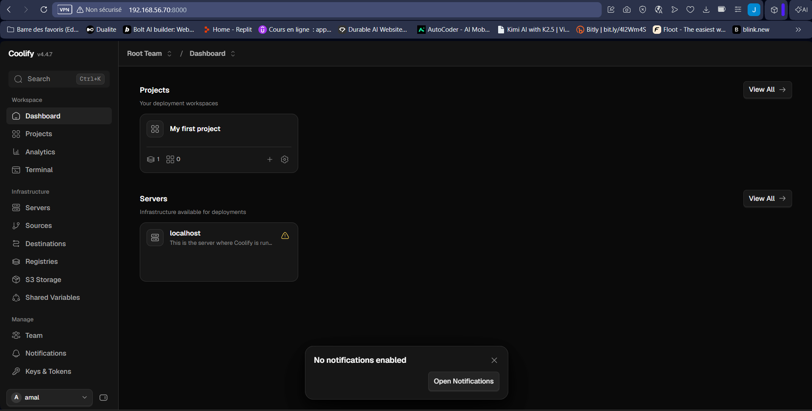

## Partie B – Forgejo

```bash
mkdir -p ~/forgejo && cd ~/forgejo
nano docker-compose.yml          # contenu : forgejo/docker-compose.yml
sudo docker compose up -d
```

Assistant d'installation sur `http://192.168.56.70:3001` : SQLite3, domaine `192.168.56.70`, port SSH `2222`, URL de base `http://192.168.56.70:3001/`, inscriptions désactivées, compte administrateur `amal`. Dépôt public **`portfolio`**, créé vide, puis :

```bash
git clone --depth 1 https://github.com/Amal356/cv-devsecops.git
cp -r cv-devsecops/portfolio-next ~/portfolio && cd ~/portfolio
git init -b main && git add . && git commit -m "Portfolio Next.js (code du TP1)"
git remote add origin http://192.168.56.70:3001/amal/portfolio.git
git push -u origin main
```

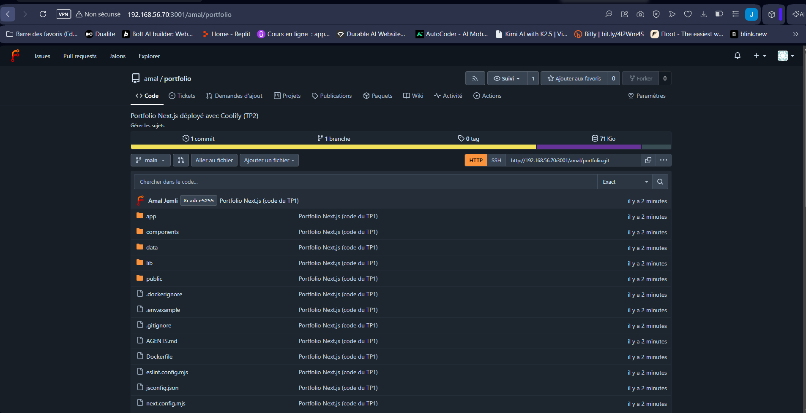

## Partie C – Déploiement

Sur le poste Windows (PowerShell administrateur), le nom local est ajouté au fichier `hosts` :

```powershell
Add-Content C:\Windows\System32\drivers\etc\hosts "`r`n192.168.56.70  portfolio.coolify.local"
```

Dans Coolify : **My first project → production → Public Git Repository**

| Réglage | Valeur |
|---|---|
| Repository URL | `http://192.168.56.70:3001/amal/portfolio.git` (IP, pas de nom d'hôte) |
| Branch | `main` |
| Build pack | **Dockerfile** (celui du portfolio, 3 étapes, `output: "standalone"`) |
| Ports exposes | `3000` |
| Domaine | protocole **http**, `portfolio.coolify.local`, port 3000 (domaine `sslip.io` et variante `www` supprimés) |

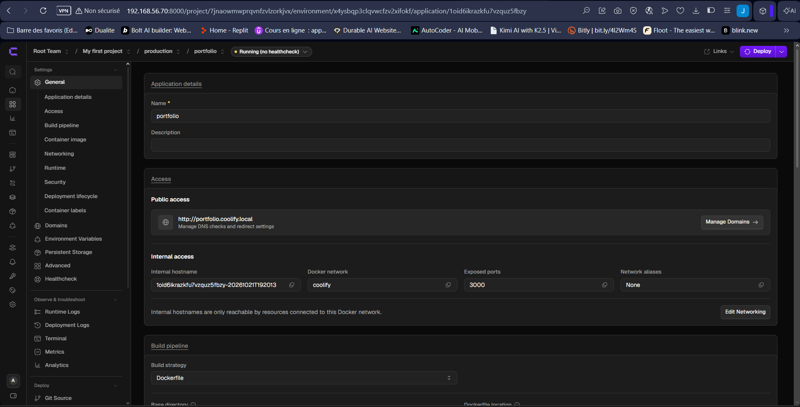

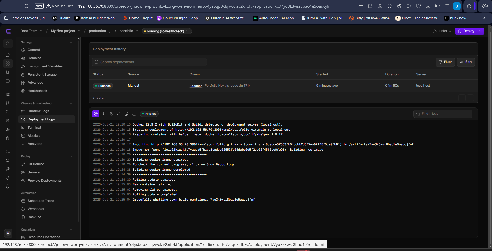

```powershell
curl.exe -I http://portfolio.coolify.local     # HTTP/1.1 200 OK – X-Powered-By: Next.js
```

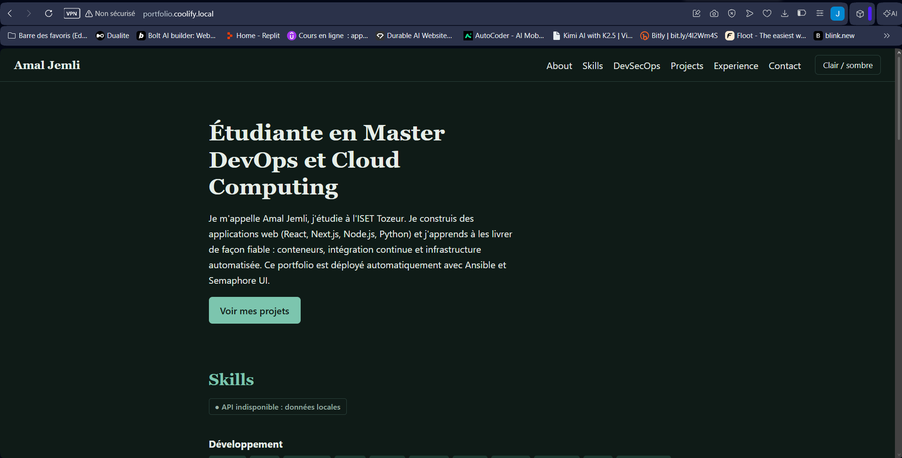

## Partie D – Webhook, déploiement automatique et rollback

**Coolify** (application → Webhooks → Manual Git webhooks → **Gitea**) : secret généré par Coolify. L'URL affichée utilise l'IP publique de la box ; on la remplace par l'IP de la VM.

**Forgejo** (dépôt → Paramètres → Webhooks → Forgejo) :

| Champ | Valeur |
|---|---|
| URL cible | `http://192.168.56.70:8000/webhooks/source/gitea/events/manual` |
| Méthode / type | `POST` / `application/json` |
| Secret | celui de Coolify (section Gitea) |
| Événement | push (« Événements de soumissions »), filtre de branche `main` |

Test de livraison : **réponse 200**.

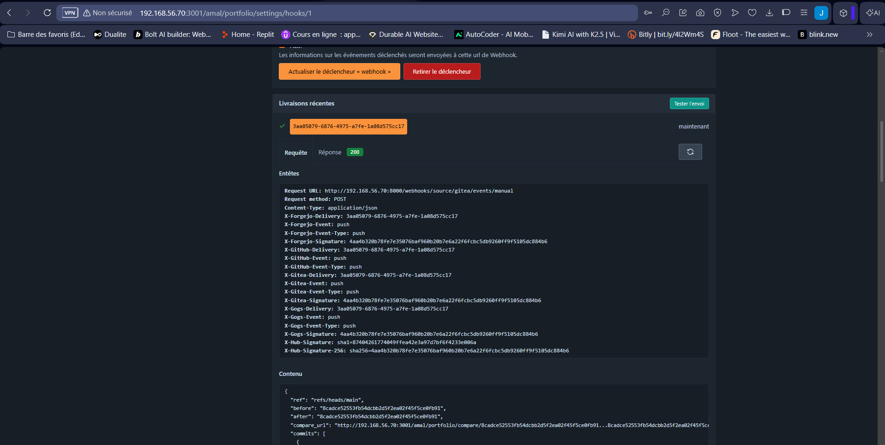

### Déploiement automatique

```bash
sed -i 's/avec Ansible et Semaphore UI/avec Coolify et Forgejo (TP2)/' $(grep -rl "Semaphore" app components)
git commit -am "Accueil : portfolio déployé avec Coolify et Forgejo" && git push
```

Coolify lance seul un déploiement **Webhook** (`33e178e`, 1 min 26 s grâce au cache Docker) ; la nouvelle phrase est en ligne sans aucun clic.

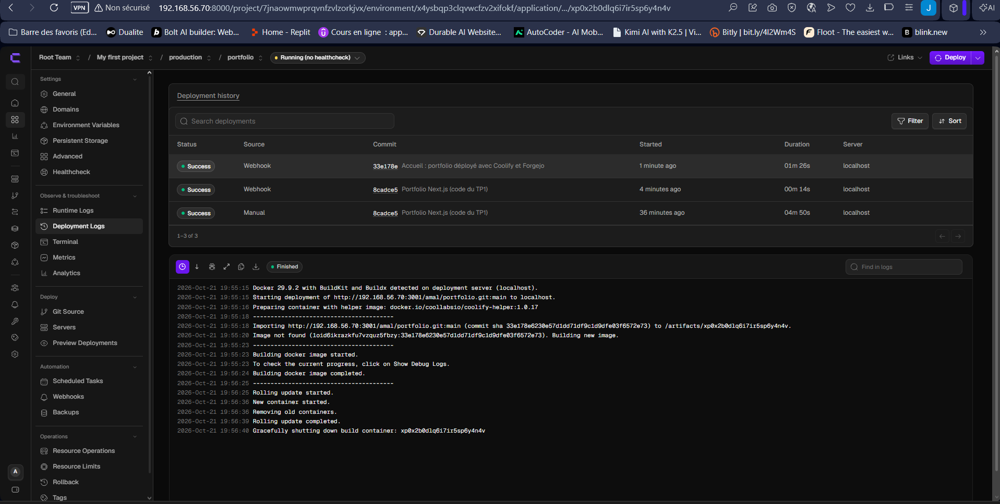

### Erreur volontaire et rollback

| Étape | Commit | Résultat |
|---|---|---|
| Erreur de syntaxe poussée | `86e1755` | build **Failed** (24 s) ; l'ancien conteneur reste en service, aucune coupure |
| Rollback (Coolify → Rollback) | → `8cadce5` | image existante relancée en **7 s** (`Build step skipped`) |
| `git revert --no-edit HEAD` + push | `1f1badd` | code corrigé, redéployé automatiquement |

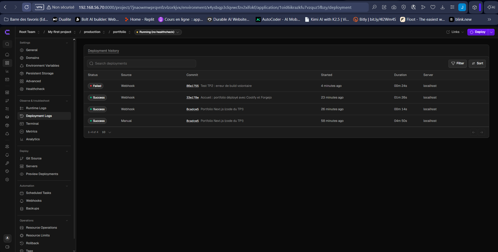

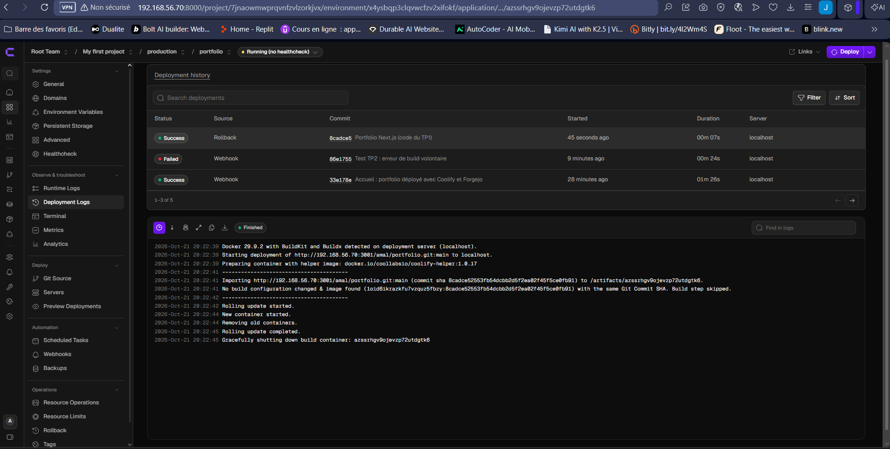

### Supervision

`sudo docker stats --no-stream` : portfolio **40 Mio**, Forgejo **151 Mio**, pile Coolify (interface, PostgreSQL, Redis, Traefik, Sentinel) **≈ 512 Mio**, CPU < 1 % au repos. Les logs sont consultables dans *Deployment Logs* et *Runtime Logs*.

## Captures complémentaires

**00-coolify-setup-complete**

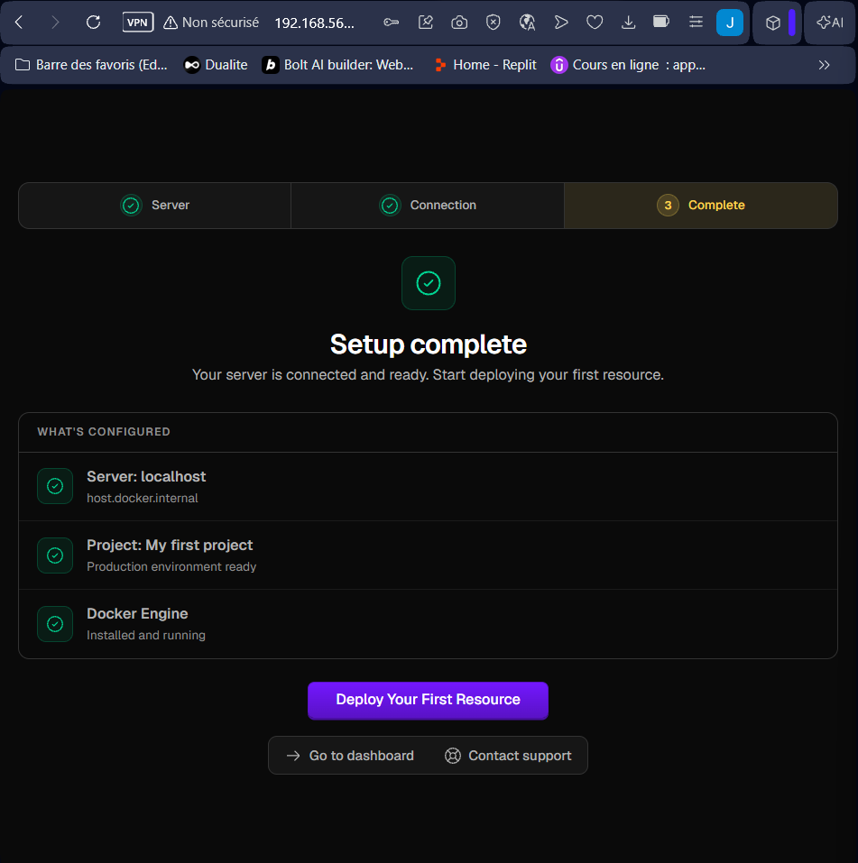

**c3-docker-ps**

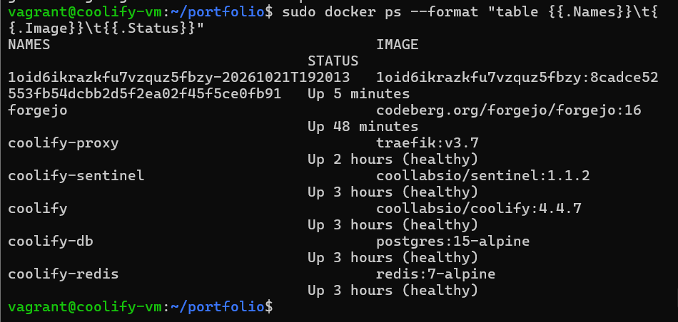

**d3-portfolio-apres-rollback**

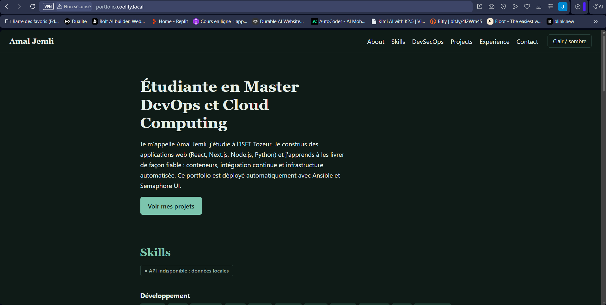

**d3-portfolio-corrige**

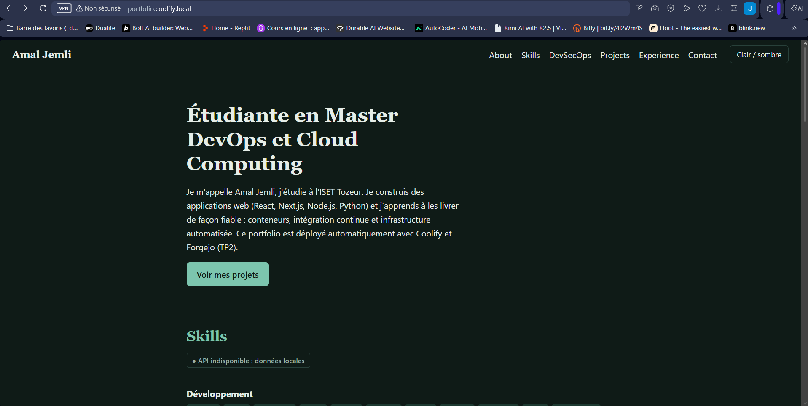

