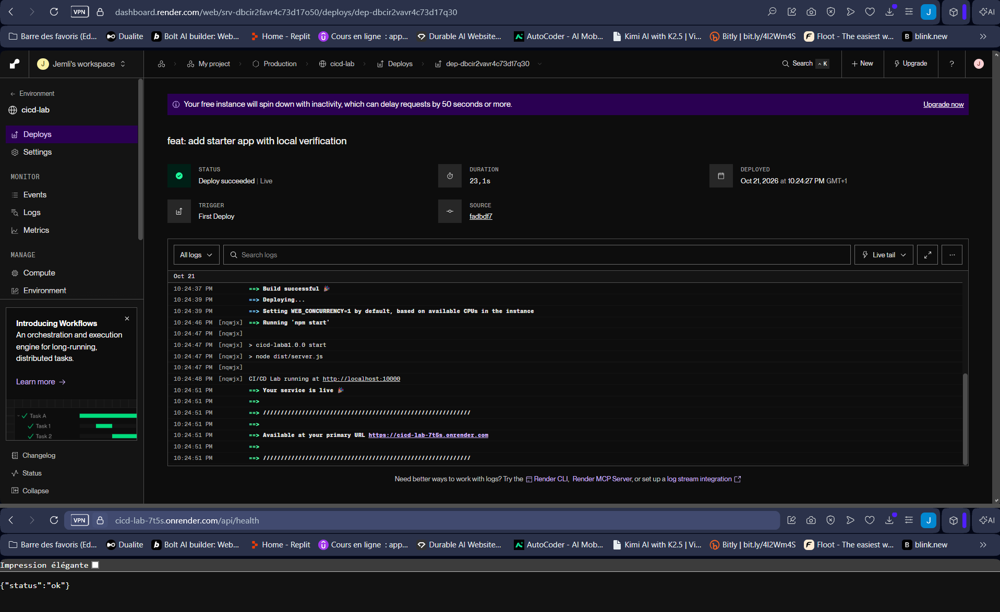
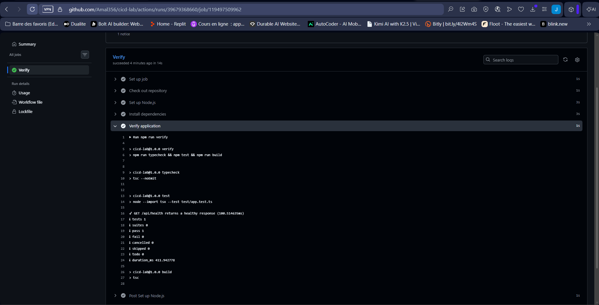
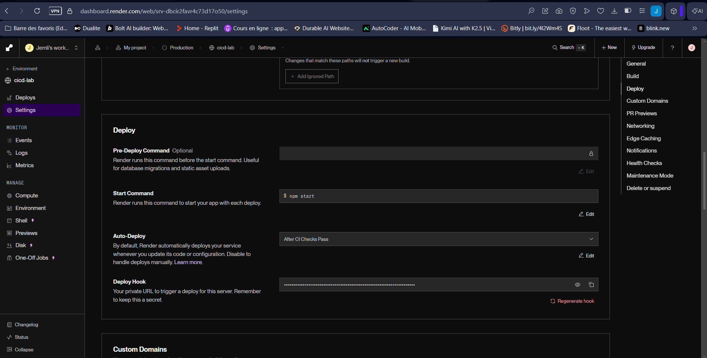
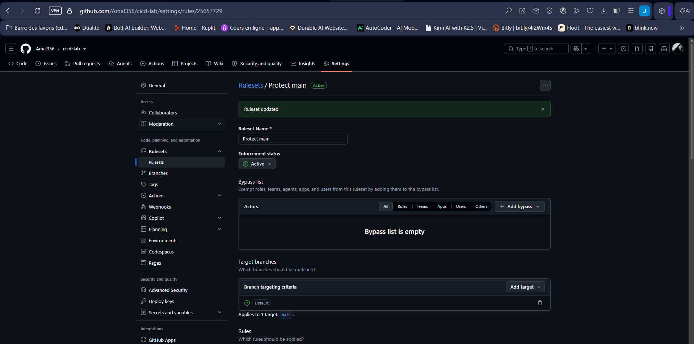
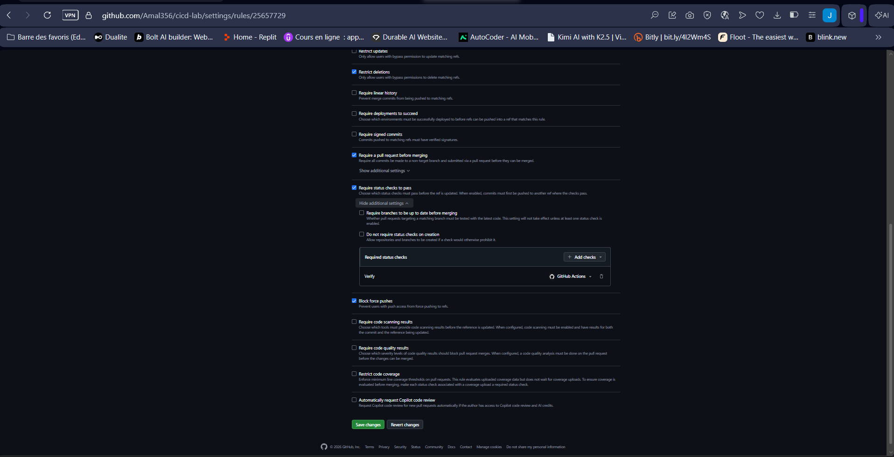
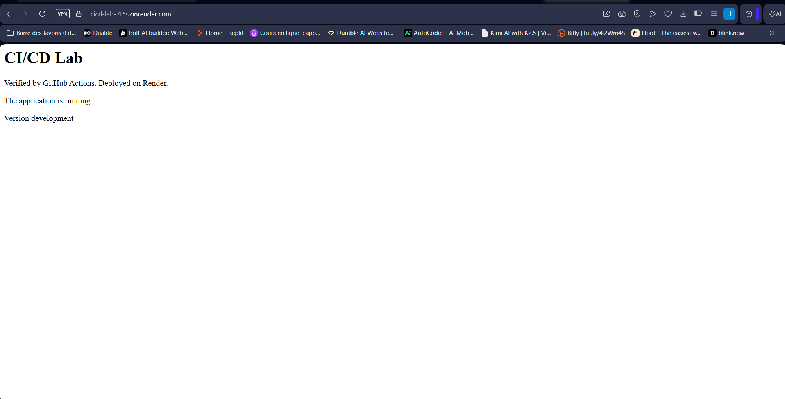
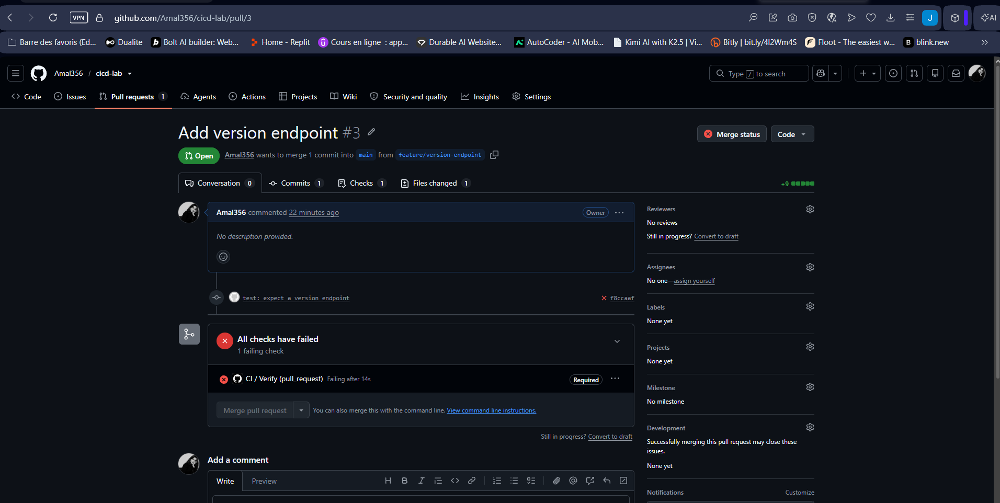
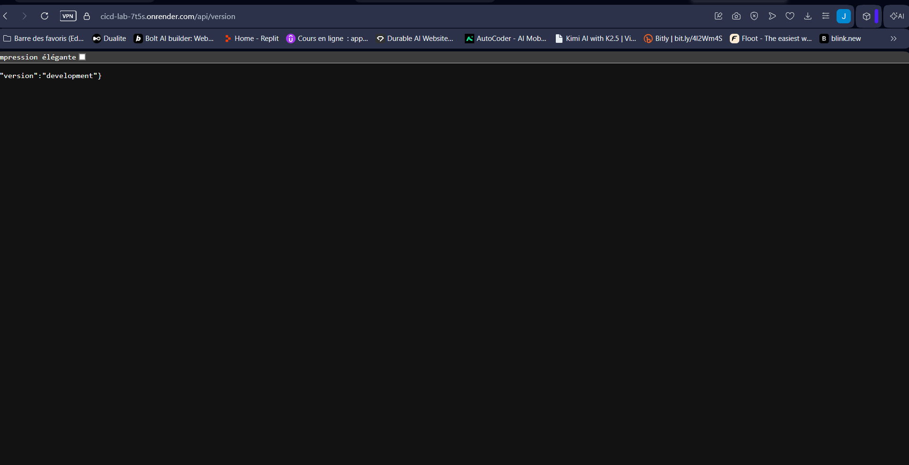
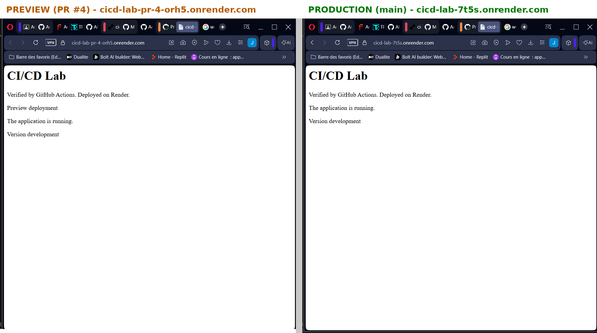

# TP3 – CI/CD avec GitHub Actions et Render

**Étudiante :** Amal Jemli – Master DevOps et Cloud Computing
**Énoncé :** [TP3 – GitHub Actions + Render](https://docs.teknolabs.net/courses/devops-cloud/partie-1-deploiement-application/tp3-github-actions-render/)

| | Lien |
|---|---|
| Dépôt du TP (workflow, ruleset, PR) | **https://github.com/Amal356/cicd-lab** |
| Application en production (Render) | **https://cicd-lab-7t5s.onrender.com** – `/api/health`, `/api/version` |
| Workflows exécutés | https://github.com/Amal356/cicd-lab/actions |
| Pull Requests #1 à #4 | https://github.com/Amal356/cicd-lab/pulls?q=is%3Apr |

Le TP utilise un dépôt séparé, `cicd-lab`, parce que le workflow GitHub Actions (`.github/workflows/`) et le ruleset doivent se trouver à la racine d'un dépôt. Ce dossier contient le rapport et les captures.

Rapport : [REPORT.md](REPORT.md) – Captures : [captures/](captures)

## Résumé

Une API Express en TypeScript est vérifiée par **GitHub Actions** (job `Verify` : typecheck, tests, build) à chaque Pull Request. Le ruleset **Protect main** interdit de fusionner tant que `Verify` n'est pas vert. Après la fusion, **Render** déploie automatiquement, mais seulement quand la CI est verte sur `main` (*After CI Checks Pass*). Chaque PR obtient aussi une **preview** temporaire.

```yaml
# .github/workflows/ci.yml (dépôt cicd-lab)
name: CI
on:
  push: {branches: [main]}
  pull_request: {branches: [main]}
permissions: {contents: read}
jobs:
  verify:
    name: Verify
    runs-on: ubuntu-latest
    timeout-minutes: 10
    steps:
      - uses: actions/checkout@v7
      - uses: actions/setup-node@v7
        with: {node-version: 24, cache: npm}
      - run: npm ci
      - run: npm run verify
```

## Étapes et preuves

| Étape | Preuve |
|---|---|
| Premier déploiement Render |  |
| CI : job Verify réussi |  |
| Auto-Deploy après la CI |  |
| Ruleset Protect main |   |
| PR #2 : page d'accueil mise à jour |  |
| PR #3 : test rouge, fusion bloquée |  |
| PR #3 corrigée : `/api/version` |  |
| PR #4 : preview et production |  |
